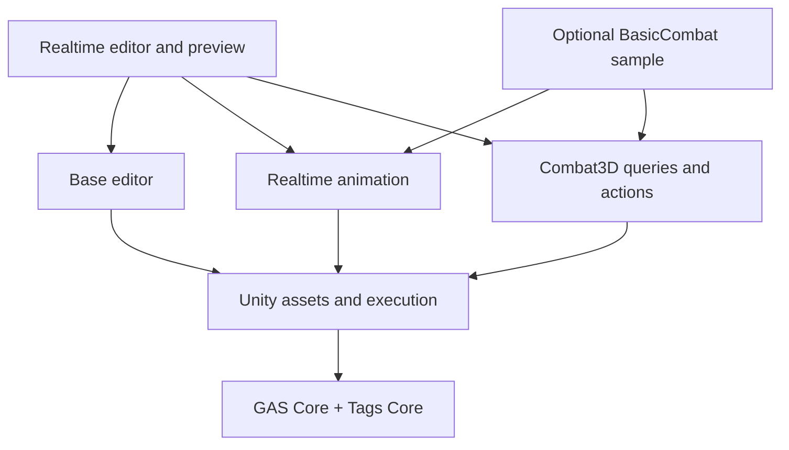

# 运行时架构

## 设计选择

GAS 提供能力和状态机制，项目提供战斗规则。核心对象只有 ASC、Attribute、Effect、Ability、Task、Tag 与 Cue；Unity 创作层把资产变成可共享的定义，表现和 3D 空间行为在扩展程序集实现。

| 应通用 | 应由扩展提供 | 应留在具体游戏 |
|---|---|---|
| 属性 Base/Current、标签计数、效果生命周期、激活/提交/取消、任务所有权 | 动画后端、时间轴、物理查询、投射物、区域、对象生成 | 阵营、伤害公式、暴击、职业、连招规则、格子/回合顺序、联网协议 |

选用当前 API 的理由是现有需求有具体差异，而不是预先为每个类创建接口。`TargetSearcher` 的唯一策略边界承担空间选敌；`ISkillTargetSource` 接入棋盘、2D 或服务器给定名单。没有独立的泛用蓝图 VM、全局调度单例或多引擎兼容层。

## 依赖

Core 使用 `noEngineReferences: true`。基础 Unity 不引用物理类型。基础 Editor 不引用实时或 3D 扩展。实时预览依赖 Combat3D，因为它需要预演相同的武器体积与投射物规则。它们仍随同一个 UPM 包交付。

## 数据与所有权

| 对象 | 所有者与寿命 | 可变性 |
|---|---|---|
| `GameplayAbilityAsset` / `GameplayEffectAsset` | Unity 资产 | 创作数据，Editor 可修改 |
| `GameplayAbilityDefinition` / `GameplayEffectDefinition` | 资产缓存，可跨单位共享 | 配置只读；Effect 数组在构造时复制 |
| `GameplayAbilitySpec` | ASC 的一次授予 | 等级、激活版本、提交状态 |
| `GameplayEffectSpec` | 一次施加 | 定义、来源、参数上下文；需要持久保存的调用方值才快照 |
| ActiveEffect | 目标 EffectContainer | 剩余时长、周期计时、堆叠、句柄 |
| `SkillExecutionContext` | 一次施放及其分支 | 目标与事件分支、缓冲区、通道、生命周期引用数 |
| `GameplayAbilityTask` | ASC 或显式外部 TaskHost | 一次运行版本；结束时释放资源 |
| `TargetQueryBuffer` | 一次同步查询/施放缓冲池 | 结果可复用；派生物理缓冲不共享 Contacts |

来源身份与对象引用分开：单位池复用同一 ASC 后，会产生新的 SourceIdentity。延迟投射物不能把旧来源或旧目标误认成复用后的实体。

## 准备和执行

1. **创作检查。** F7 和 Player build 共用严格校验。检查真正构造定义，也验证未引用资产与调用位置的参数作用域。
2. **Grant。** 构造并缓存 Definition、ActionDefinition 和参数值，建立 Spec。Player 不在每次 Cast 比较作者配置是否变化。
3. **Activate。** 检查标签、冷却、初始可支付性，建立激活版本并授予激活期标签。
4. **Commit。** 默认立即执行，也可等待确认动作；再次检查支付条件，至多提交一次。
5. **Execute。** 顺序执行已构建动作；跨帧工作提交给所属 TaskHost；表现播放器订阅 CastStarted。
6. **End。** 移除该激活实际发布的标签，取消该版本的能力任务。场景任务由自己的宿主继续推进和释放。

ASC.Clear 后，原授予失效。Runner 查询不会重新授权，项目必须显式 Grant/GrantTo。这使回收、换装与重新初始化的责任可见。

### 当前构建边界

ActionDefinition 是内存中的运行定义，部分动作封装已捕获配置的委托。首次 Grant 仍执行 Build。编辑器的图形坐标与布局不参与运行，但 ScriptableObject 作者资产仍随引用进入 Player。

目前没有持久化 Program、离线字节码导出、跨机器确定性 hash 或网络预测。将这些作为已完成特性会误导接入方。若未来选择离线 Program，须先定义可序列化的操作数据与扩展注册合同，再替代当前 Build 委托；不能只增加一个 Program 类名。

## 激活与提交的细节

- 手动模式在激活时也检查是否能够支付，但不扣费、不启动冷却。
- 同一激活第一次成功 Commit 设置 IsCommitted。随后重复 Commit 直接返回成功，不重新扣费或刷新冷却。
- 延迟确认传入捕获的 ActivationVersion；旧版本返回 Inactive。
- 资源不足或共享冷却已出现时，Commit 不付款。Unity 的提交动作结束本次施放。
- 如果付款回调结束或撤销能力，已发生的付款不退款，结果返回 Inactive，Runner 不向已结束能力启动任务。
- 回调异常由明确的宿主入口处理；不加入聚合异常、自动重试或隐式退款协议。

## 时钟与效果

所有规则时间来自调用方的 Tick。实时、回合步进、暂停与测试可以使用不同时间来源。

Duration 周期效果累计 `min(deltaTime, remaining)`，有效期终点恰好到达的周期会结算，之后不会再结算。周期作用到 BaseValue；持续 modifier 只参与 CurrentValue。属性聚合保持本库的乘积规则，不把它标为 UE Aggregator 的完全复刻。

Effects.Count 使用活跃数量减待移除数量，O(1)。没有待删除效果时不扫描清理。操作作用域内的暂缓回收防止回调移除对象后，外层还在引用已复用的池对象。

## 选敌与宿主

基础 TargetSearcher 负责 Self、FixedTarget、Project，公共 SkillTargetResults 负责过滤、去重和排序。PhysicsTargetSearcher 才查询 3D PhysicsScene。项目可实现自己的空间策略，或直接提供排序后的名单。

通过 searcher.CreateBuffer 创建缓冲区；物理实现的派生缓冲含 Collider 数组。嵌套查询分别租借缓冲，查询结束归还。容量耗尽会报告 Saturated；不会为追求完整结果在热路径自动扩容。

对象服务与场景任务必须注入。SceneSkillTaskHost 是可主动添加的 FixedUpdate 接入组件，不是被库偷偷创建的全局服务。对象池、物理同步、阵营关系由项目决定。

## 诊断与性能

- Editor 中维护 Definition → 资产和依赖失效图，Player 中不分配这些弱表。
- 诊断通知仅在 Editor、Development Build 或 GAS_DIAGNOSTICS 下调用。
- 正常 Cast 不重新遍历作者动作做预检。配置检查放在编辑/构建/授予边界。
- generation、版本、回调中断和所有权判断是算法正确性，保留。
- 预热 Core 的已测路径为 0 B；Unity 分支对象、首次构造和对象生成仍可能分配。以 Profiler/IL2CPP 实测作为目标平台结论。

## 参考与取舍

- [UE GAS Overview](https://dev.epicgames.com/documentation/en-us/unreal-engine/understanding-the-unreal-engine-gameplay-ability-system)：能力所有权、状态、任务与表现分工。
- [UE CommitAbility](https://dev.epicgames.com/documentation/unreal-engine/BlueprintAPI/Ability/CommitAbility)：将激活和最后的资源提交分开。
- [UE Gameplay Effects](https://dev.epicgames.com/documentation/unreal-engine/gameplay-effects-for-the-gameplay-ability-system-in-unreal-engine)：共享定义、Spec、持续与周期语义。
- [UniTask](https://github.com/Cysharp/UniTask)：显式生命周期、可复用调度和测量分配；没有为了参考它而强制引入 async。
- [UniText](https://github.com/LightSideKittens/UniText)：借鉴共享处理器与实例工作缓冲的职责分离；不引入文本管线依赖。
- [Luban](https://github.com/focus-creative-games/luban)：借鉴前置语义校验与运行消费分离；本版尚未实现其离线导出模式。
